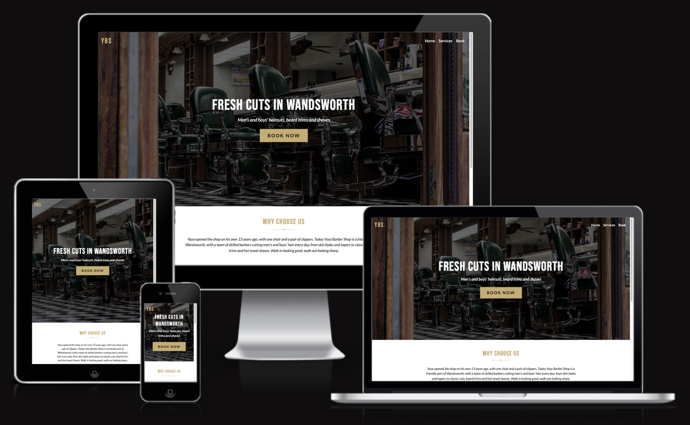
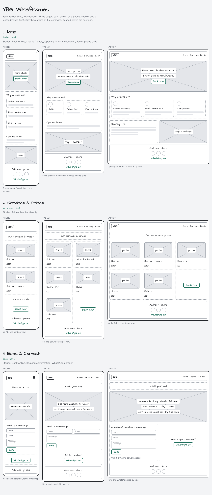
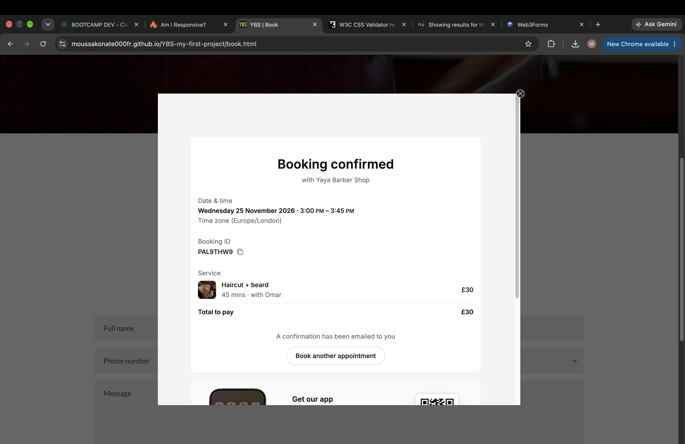
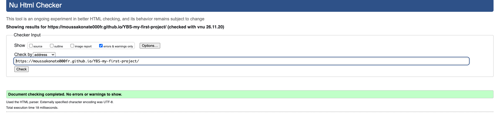
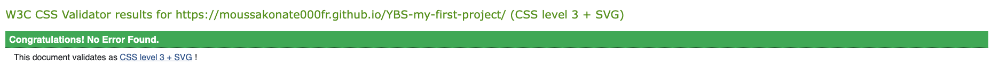

# YBS – Yaya Barber Shop

YBS is a website for Yaya Barber Shop, a barber shop for men and boys in Wandsworth, London. The site shows the services and prices, the opening hours and the location, and lets customers **book an appointment online** in a few clicks.

The main goal is simple: more bookings and fewer phone calls for the shop.

**Live site:** https://moussakonate000fr.github.io/YBS-my-first-project/

**Repository:** https://github.com/moussakonate000fr/YBS-my-first-project

---

## Table of contents

1. [User experience (UX)](#user-experience-ux)
2. [Design](#design)
3. [Features](#features)
4. [Technologies used](#technologies-used)
5. [Why Setmore and Web3Forms](#why-setmore-and-web3forms)
6. [Testing](#testing)
7. [Bugs](#bugs)
8. [Deployment](#deployment)
9. [Credits](#credits)

---

## User experience (UX)

### Who is the site for?

- Men and boys (and their parents) living or working near Wandsworth who want a haircut, a beard trim or a shave.
- Most of them will use a phone, so the site is built **mobile first**.

### Site owner's goal

- Get more bookings online and spend less time answering the phone.
- Show the prices clearly so customers know what to expect.

### User stories

I planned the project with a GitHub Project board ("YBS user stories") and gave each story a MoSCoW label.

| # | User story | Priority |
|---|---|---|
| 1 | As a customer, I want to book an appointment online, so I don't have to call. | Must have |
| 2 | As a customer, I want the site to work well on my phone, so I can book on the go. | Must have |
| 3 | As a customer, I want to see the opening times and the location on a map, so I know when and where to go. | Must have |
| 4 | As a customer, I want to see the services and prices, so I know the cost before I book. | Should have |
| 5 | As a customer, I want a confirmation of my booking, so I know it worked. | Should have |
| 6 | As the shop owner, I want customers to book and ask questions online, so I get fewer phone calls. | Should have |
| 7 | As a customer, I want to message the shop on WhatsApp, so I can ask a quick question. | Could have |

All 7 stories are in the **Done** column of the board.

---

## Design

### Wireframes

I planned wireframes for the 3 pages on phone, tablet and laptop before coding (made with AI help, see the AI declaration). The finished site follows them, except that the Services page shows each service as a row with a small photo on phones.

### Colours

The design is inspired by the dark and gold look of [Icon Barbers](https://www.iconbarbers.co.uk/). The colours are saved as CSS variables in `:root`, so I can change them in one place.

| Name | Hex | Used for |
|---|---|---|
| Dark | #1a1a1a | Text, footer |
| Light | #f7f5f2 | Page background |
| Gold | #c9ad6e | Logo, titles, buttons, icons |
| Grey | #6b6b6b | Small text |

### Fonts

- **Bebas Neue** (Google Fonts) for headings and the logo: tall and bold, like a barber shop sign.
- **Lato** (Google Fonts) for the text: clean and easy to read.

---

## Features

### On every page

- **Navbar** over the hero photo, with the YBS logo and links to Home, Services and Book. On phones it turns into a burger menu. The current page is underlined (`active` + `aria-current`).
- **Hero** banner with a photo, a dark layer so the white text is readable, and a gold "Book now" button.
- **Footer** with the address, the phone number and social links (WhatsApp, Instagram, Facebook, TikTok) that open in a new tab.
- **Favicon** (gold "Y" on dark).

### Home page (index.html)

- "Why choose us": a short welcome paragraph about the shop, then 3 boxes with icons (skilled barbers, book online 24/7, fair prices).
- Opening hours with dotted gold lines between the day and the time.
- Google Map showing the shop.

### Services page (services.html)

- The 5 services with a photo, a short description, the price and how long it takes.
- **Responsive layout**: one row per service on a phone (photo left, text right), 2 cards per line on a tablet, 3 cards per line on a laptop.
- A "Book now" button that goes to the Book page.

### Book page (book.html)

- **Online booking with Setmore**: the customer picks a service, a barber (Yaya, Omar, Sam or Bob), a day and a time. Setmore sends a confirmation email.
- **Contact form** (name, email, phone, service, message) sent with Web3Forms.
- Phone, email and address, with clickable phone and email links.

### Thank-you page (thankyou.html)

- After sending the contact form, the customer lands on my own thank-you page instead of a plain success message, with buttons back to Home or to book online.

### Future features

- A gallery of haircuts.
- Customer reviews.
- Prices for extra services (hair colour, hot towel).

---

## Technologies used

- HTML5 and CSS3
- [Bootstrap 5.3](https://getbootstrap.com/) for the grid, navbar, buttons and spacing
- [Font Awesome](https://fontawesome.com/) for the icons
- [Google Fonts](https://fonts.google.com/) for Bebas Neue and Lato
- [Setmore](https://www.setmore.com/) for online booking
- [Web3Forms](https://web3forms.com/) to send the contact form by email
- [Google Maps](https://www.google.com/maps) embed for the map
- [favicon.io](https://favicon.io/) for the favicon
- VS Code, Git and GitHub, GitHub Pages
- Chrome DevTools for testing on different screen sizes

---

## Why Setmore and Web3Forms

A GitHub Pages site is **static**: it has HTML and CSS only, no server and no database. So it can't save bookings or send emails by itself.

### Setmore (booking)

I compared Setmore, Square Appointments, Fresha and SimplyBook.me. I chose **Setmore** because:

- The free plan is enough for a small shop (several barbers, unlimited bookings).
- It gives a "Book now" button I can **embed** on a static site with 2 lines of code (a button and a script).
- Customers can choose their barber, and they get a **confirmation email** automatically (user story 5).
- The owner sees all bookings in one calendar, so there are fewer phone calls (user story 6).

### Web3Forms (contact form)

HTML can't send an email on its own. The form posts its fields to Web3Forms, which emails them to the shop. A hidden `redirect` input then sends the visitor to my `thankyou.html` page.

The `access_key` in the form is **public by design**: it only says which inbox to send to, so it is safe to have it on GitHub.

---

## Testing

### Manual testing

| Test | Expected result | Result |
|---|---|---|
| Click each navbar link on each page | The right page opens and its link is active | Pass |
| Open the site on a phone and tap the burger | The menu opens and closes | Pass |
| Click "Book now" on the Home and Services pages | The Book page opens | Pass |
| Click "Book now" on the Book page | The Setmore booking window opens | Pass |
| Make a test booking in Setmore | "Booking confirmed" screen shown and confirmation email received | Pass |
| Send the contact form with all fields | Email received and thank-you page shown | Pass |
| Send the contact form with an empty field | The browser asks me to fill it in | Pass |
| Type an email without @ | The browser says the email is not valid | Pass |
| Click the phone number on a phone | The phone app opens with the number | Pass |
| Click the social icons | The site opens in a new tab | Pass |
| Check the Services page on phone, tablet and laptop | 1 row, then 2 cards, then 3 cards per line | Pass |

### Validation

| Page | W3C HTML validator | Result |
|---|---|---|
| index.html | https://validator.w3.org/nu/ | Pass: no errors or warnings |
| services.html | https://validator.w3.org/nu/ | Pass: no errors or warnings |
| book.html | https://validator.w3.org/nu/ | Pass: no errors or warnings |
| thankyou.html | https://validator.w3.org/nu/ | Pass: no errors or warnings |
| style.css | https://jigsaw.w3.org/css-validator/ | Pass: no errors |

The HTML validator shows some green "Info" messages about the `/` at the end of tags like `meta`, `link` and `img`. Prettier adds it when it formats my code. It has no effect, so I left it.

The CSS validator shows 4 warnings: "Due to their dynamic nature, CSS variables are currently not statically checked". This only means the validator can't check `var(--gold)` and my other colour and font variables. It is not an error.

### Lighthouse

| Page | Performance | Accessibility | Best practices | SEO |
|---|---|---|---|---|
| Home | 72 to 83 | 95 | 77 | 100 |
| Services | 72 to 77 | 95 | 100 | 100 |
| Book | 75 to 87 | 96 | 77 | 100 |

Tested on **mobile** (Lighthouse's hardest setting: slow phone and slow network). The Performance score changes a little each time I run it, so I give the range.

- **Performance:** my photos came straight from Pexels and weighed 24 MB in total. I resized and compressed them to about 1 MB, with the same file names. The score left is mostly the time it takes to load Bootstrap, Font Awesome and Google Fonts from other websites.
- **Best practices 77 on Home and Book:** Lighthouse says "Uses third-party cookies: 18 cookies found". They come from the Google Map (Home) and the Setmore booking script (Book). They are other companies' tools and they set third-party cookies, which I can't change. The Services page has neither, and it scores 100.

### Browsers and devices

Tested in Chrome and Safari on a Mac, on an iPhone, and with Chrome DevTools (phone, iPad and laptop sizes).

---

## Bugs

| Bug | Cause | Fix |
|---|---|---|
| The burger icon was invisible on phones | `data-bs-theme="dark"` had been removed from the nav, so the icon was dark on a dark photo | Added it back on every page |
| 404 error for the favicon in the console | There was no favicon yet | Added favicon files in `assets/favicon` with relative paths |
| Favicon paths from favicon.io didn't work | They start with `/`, which points to the wrong folder on GitHub Pages | Used relative paths (`assets/favicon/...`) |
| The thank-you page showed a 404 | The new file was not saved and pushed yet | Saved, committed and pushed `thankyou.html` |
| The service photos were huge and the styles didn't work | A `}` was missing at the end of the `.section-title::after` rule, so the next CSS rules were inside it | Added the missing `}` |
| W3C error on services.html: "Unclosed element div" | When I changed the cards to rows, I deleted the closing `
` of the container by mistake | Added `
` before `</section>` |
| Lighthouse Performance was low | The Pexels photos were huge (up to 6720px wide, 24 MB in total) | Resized and compressed them to about 1 MB in total |
| Lighthouse SEO was 90 | My pages had no meta description | Added a `meta name="description"` line to the head of every page (SEO went to 100) |
| Service photos had different shapes | Each photo had a different size | `aspect-ratio: 4 / 3` and `object-fit: cover` |

No known bugs left.

---

## Deployment

The site is deployed with **GitHub Pages**:

1. In the GitHub repository, go to **Settings > Pages**.
2. Under "Build and deployment", choose **Deploy from a branch**.
3. Choose the **main** branch and the **/ (root)** folder, then **Save**.
4. After a minute or two, the live link appears at the top of the Pages page.

### Run it on your computer

1. Clone the repository: `git clone https://github.com/moussakonate000fr/YBS-my-first-project.git`
2. Open the folder in VS Code.
3. In the terminal, run `python3 -m http.server` and open http://localhost:8000

---

## Credits

### Content

- The shop, the barbers, the address, the phone number and the email are made up for this project.

### Photos (all from Pexels, free to use)

- Home hero (vintage barber chairs): photo by wal_172619 on [Pexels](https://www.pexels.com/)
- Services hero ("Person holding a gold razor"): photo by RDNE Stock project on [Pexels](https://www.pexels.com/photo/person-holding-a-gold-razor-7697316/)
- Book hero (red barber chair): photo by Ryan Klaus on [Pexels](https://www.pexels.com/photo/a-red-barber-leather-padded-chair-12304516/)
- Haircut: photo by Sự Minh on [Pexels](https://www.pexels.com/photo/unrecognizable-hands-trimming-male-haircut-with-trimmer-11333875/)
- Haircut + beard: photo by Brian Silva on [Pexels](https://www.pexels.com/photo/man-smiling-during-a-haircut-in-barbershop-39559309/)
- Beard trim: photo by RDNE Stock project on [Pexels](https://www.pexels.com/photo/barber-shaving-customer-with-a-razor-7697441/)
- Shave: photo by RDNE Stock project on [Pexels](https://www.pexels.com/photo/a-barber-covering-a-client-s-face-hot-towel-7697492/)
- Kids cut: photo by RDNE Stock project on [Pexels](https://www.pexels.com/photo/boy-in-blue-long-sleeves-shirt-sitting-on-barber-chair-7697398/)

### Code and design

- [Bootstrap 5.3 docs](https://getbootstrap.com/docs/5.3/): navbar, grid, cards, forms, ratio and spacing utilities.
- Setmore's "Book now" embed code, changed to use my own Bootstrap classes.
- Web3Forms docs for the form `action`, `access_key` and `redirect`.
- Design inspired by [Icon Barbers](https://www.iconbarbers.co.uk/) (colours and gold titles). No code was copied.
- Code Institute's Love Running and Boardwalk Games walkthrough projects, which taught me the structure I reused.

### AI

I used Claude (an AI assistant) as a tutor during this project: to explain Bootstrap classes, to suggest code that I then pasted, tested and changed, to help me find bugs, and to help write this README. I can explain how each part of the site works.

### Thanks

- My tutors, Munawar and Arthur, for their feedback on the proposal, the design and the code.
